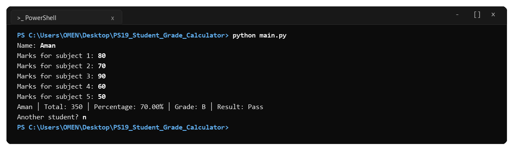
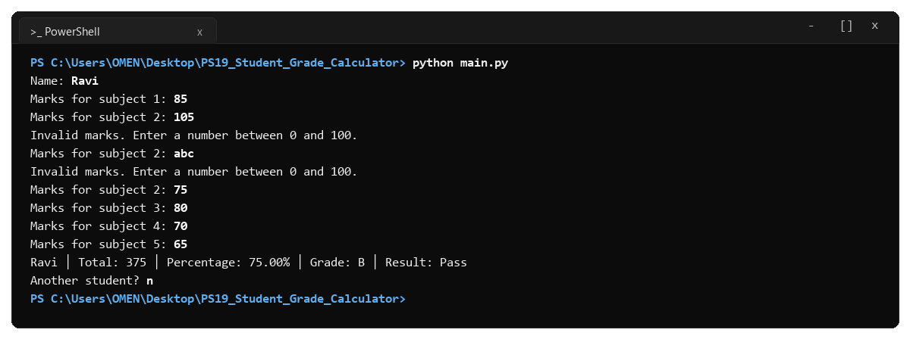
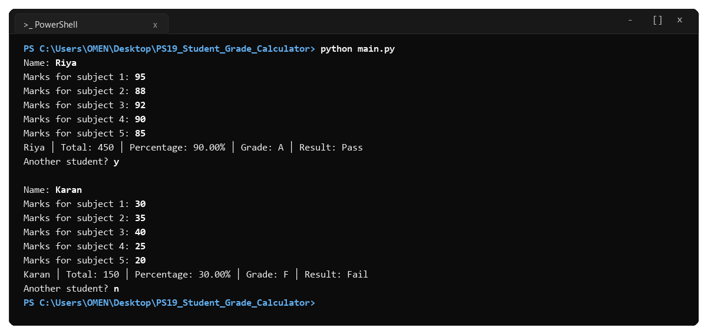

# Student Grade Calculator (Problem Statement No. 19)

- **Course:** Programming Fundamentals and Logic Building Using Python (`RU-100-01-0021`)
- **Institution:** Rungta International Skills University (RISU)
- **School:** School of Computer Science and Engineering
- **Program:** B.Tech CSE (First Semester, Section K)
- **Submission Date:** 16th November 2026

---

## 1. Problem Statement

Create a Python 3 console program that takes a student's name and marks in five subjects, calculates the total marks, percentage, letter grade, and pass/fail result, and allows more students to be entered using a loop.

- **Language:** Python 3 (Standard Library only)
- **Concepts Used:** Variables, Functions, Conditions (`if-elif-else`), While Loop, Input Validation (`try-except`)

---

## 2. Grading and Passing Rules

- Total Subjects: 5
- Maximum Marks Per Subject: 100 (Total Maximum = 500)
- Passing Criterion: Student passes with 40% or more.

### Grading Scale:
| Percentage Range | Grade | Result |
|---|:---:|:---:|
| 85% and above | **A** | Pass |
| 70% to 84.99% | **B** | Pass |
| 55% to 69.99% | **C** | Pass |
| 40% to 54.99% | **D** | Pass |
| Below 40% | **F** | Fail |

### Formulae:
- Total Marks = Subject 1 + Subject 2 + Subject 3 + Subject 4 + Subject 5
- Percentage = Total Marks / 5

---

## 3. Function Breakdown

| Function | Inputs | Output | Purpose |
|---|---|---|---|
| `calculate_total(marks)` | List of marks | `int` / `float` | Returns the sum of 5 subject marks. |
| `calculate_percentage(total)` | Total marks | `float` | Returns percentage out of 100. |
| `find_grade(percentage)` | Percentage | `str` | Returns grade `A`, `B`, `C`, `D`, or `F`. |
| `find_result(percentage)` | Percentage | `str` | Returns `Pass` (if >= 40%) or `Fail`. |
| `read_mark(subject_number)` | Subject index (1 to 5) | `int` / `float` | Validates that mark is numeric and between 0 and 100. Prompts again if invalid. |
| `process_student()` | None | `dict` | Takes name and marks, computes results, prints report line. |
| `main()` | None | None | Runs the interactive loop with `Another student? ` prompt. |

---

## 4. Official Test Cases & Verification

### Test Case 1: Normal Input
- **Input:** Name: Aman | Marks: 80, 70, 90, 60, 50
- **Expected Output:** `Aman │ Total: 350 │ Percentage: 70.00% │ Grade: B │ Result: Pass`


---

### Test Case 2: Boundary / Minimum Input (Pass Limit)
- **Input:** Name: Neha | Marks: 40, 40, 40, 40, 40
- **Expected Output:** `Neha │ Total: 200 │ Percentage: 40.00% │ Grade: D │ Result: Pass`


---

### Test Case 3: Invalid Input Recovery
- **Input:** Name: Ravi | Subject 2: 105 -> abc -> 75
- **Expected Output:** Warning `Invalid marks. Enter a number between 0 and 100.` twice, then accepts 75.


---

### Test Case 4: Multiple Students (Loop)
- **Input:** (a) Riya (95, 88, 92, 90, 85) -> Continue: y -> (b) Karan (30, 35, 40, 25, 20) -> Continue: n
- **Expected Output:**
  - `Riya │ Total: 450 │ Percentage: 90.00% │ Grade: A │ Result: Pass`
  - `Karan │ Total: 150 │ Percentage: 30.00% │ Grade: F │ Result: Fail`


---

## 5. How to Run

```bash
python main.py
```

---

## 6. Syllabus Checklist Verification
- [x] Python 3 single `.py` console program.
- [x] Takes student name and 5 subject marks.
- [x] Separate functions `calculate_total()` and `calculate_percentage()`.
- [x] Uses `if-elif-else` for grade and pass/fail result.
- [x] Validates marks between 0 and 100.
- [x] Allows multiple students using a loop.
