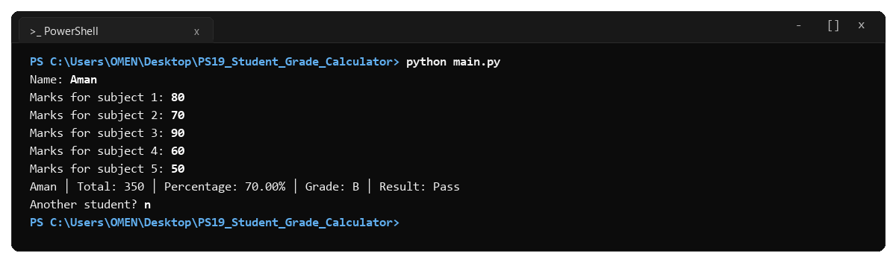
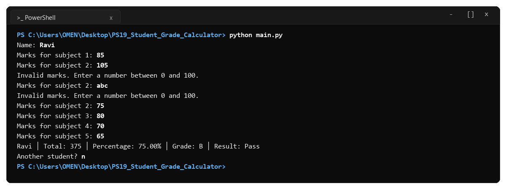
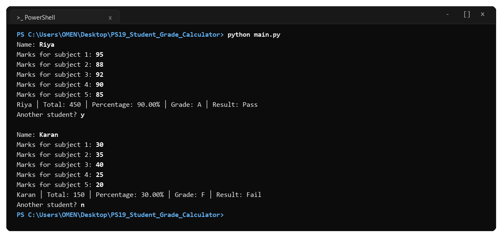

# Project Summary: Student Grade Calculator (PS No. 19)

- **Course:** Programming Fundamentals and Logic Building Using Python (`RU-100-01-0021`)
- **Institution:** Rungta International Skills University (RISU)
- **School:** School of Computer Science and Engineering
- **Class:** B.Tech CSE (First Semester, Section K)
- **Status:** Complete and Verified

---

## 1. Project Overview

This project implements **Problem Statement No. 19 (Student Grade Calculator)** from the official `Project_Description_1K.pdf` syllabus (Page 20).

The program runs in the console, takes a student's name and marks for 5 subjects, validates that the marks are numbers between 0 and 100, and calculates:
1. **Total Marks:** Sum of marks across all 5 subjects.
2. **Percentage:** Total marks divided by 5 (each subject is out of 100).
3. **Grade:** Letter grade using the required scale (`A`, `B`, `C`, `D`, `F`).
4. **Result:** `Pass` if percentage is 40% or more, otherwise `Fail`.
5. **Loop:** Asks `Another student? ` so more records can be entered without closing the program.

---

## 2. Test Cases Execution Log

### Test Case 1: Normal Input
- **Input:** Name: `Aman` | Marks: `80, 70, 90, 60, 50`
- **Console Run:**
```text
Name: Aman
Marks for subject 1: 80
Marks for subject 2: 70
Marks for subject 3: 90
Marks for subject 4: 60
Marks for subject 5: 50
Aman │ Total: 350 │ Percentage: 70.00% │ Grade: B │ Result: Pass
Another student? n
```


---

### Test Case 2: Boundary / Minimum Input (Pass Limit)
- **Input:** Name: `Neha` | Marks: `40, 40, 40, 40, 40`
- **Console Run:**
```text
Name: Neha
Marks for subject 1: 40
Marks for subject 2: 40
Marks for subject 3: 40
Marks for subject 4: 40
Marks for subject 5: 40
Neha │ Total: 200 │ Percentage: 40.00% │ Grade: D │ Result: Pass
Another student? n
```


---

### Test Case 3: Invalid Input Recovery
- **Input:** Name: `Ravi` | Subject 2: `105` -> `abc` -> `75`
- **Console Run:**
```text
Name: Ravi
Marks for subject 1: 85
Marks for subject 2: 105
Invalid marks. Enter a number between 0 and 100.
Marks for subject 2: abc
Invalid marks. Enter a number between 0 and 100.
Marks for subject 2: 75
Marks for subject 3: 80
Marks for subject 4: 70
Marks for subject 5: 65
Ravi │ Total: 375 │ Percentage: 75.00% │ Grade: B │ Result: Pass
Another student? n
```


---

### Test Case 4: Multiple Students (Loop)
- **Input:**
  - Student 1: `Riya` (Marks: `95, 88, 92, 90, 85`), loop: `y`
  - Student 2: `Karan` (Marks: `30, 35, 40, 25, 20`), loop: `n`
- **Console Run:**
```text
Name: Riya
Marks for subject 1: 95
Marks for subject 2: 88
Marks for subject 3: 92
Marks for subject 4: 90
Marks for subject 5: 85
Riya │ Total: 450 │ Percentage: 90.00% │ Grade: A │ Result: Pass

Another student? y

Name: Karan
Marks for subject 1: 30
Marks for subject 2: 35
Marks for subject 3: 40
Marks for subject 4: 25
Marks for subject 5: 20
Karan │ Total: 150 │ Percentage: 30.00% │ Grade: F │ Result: Fail

Another student? n
```


---

## 3. Requirements Check

| Syllabus Requirement | Fulfilled By | Result |
|---|---|:---:|
| Single `.py` file executed in console | `main.py` | PASS |
| Input student name and 5 subject marks | `read_mark()` and `process_student()` | PASS |
| Dedicated calculation functions | `calculate_total()`, `calculate_percentage()` | PASS |
| `if-elif-else` for grade and result | `find_grade()`, `find_result()` | PASS |
| Validates marks (0 to 100) | `read_mark()` with bounds check and `ValueError` catch | PASS |
| Multi-student loop | `main()` with `Another student? ` prompt | PASS |
